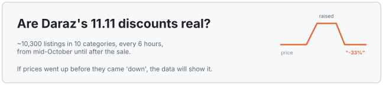
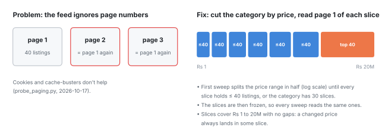
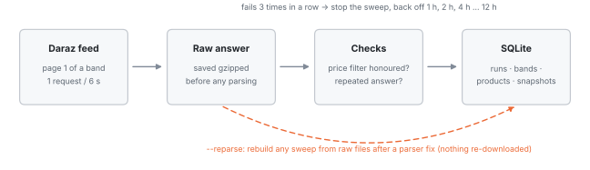
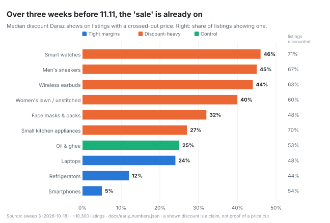
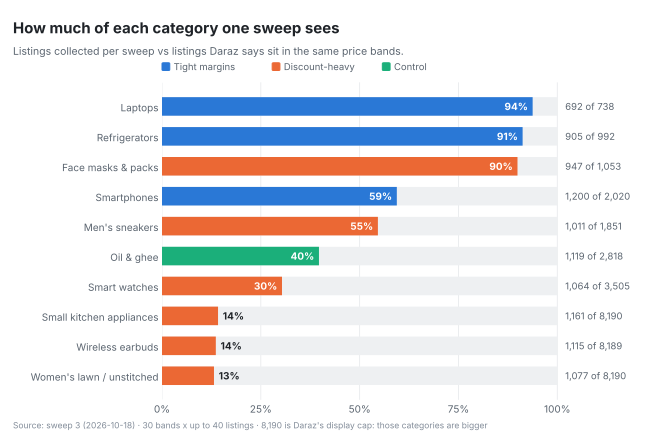

<picture>
  <source media="(prefers-color-scheme: dark)" srcset="assets/diagrams/banner-dark.svg">
  
</picture>


Every year Daraz's 11.11 sale is covered in "up to 70% off" labels. The question this project asks is simple: **how many of those discounts are real price cuts, and how many are prices that went up first and came back "down"?**

You can't answer that from one look at the sale page. You need each listing's price before the sale, recorded the same way, often enough to catch a quiet price hike. So this repo is a collector that does exactly that, plus the checks that keep its data trustworthy.

**[The short version](#the-short-version)** · **[How it collects](#how-it-collects)** · **[Early look](#early-look-before-the-sale)** · **[Keeping the data honest](#keeping-the-data-honest)** · **[How the verdict will be made](#how-the-verdict-will-be-made)** · **[Run it yourself](#run-it-yourself)** · **[Who did what](#who-did-what)**

---

## The short version

**What it does.** Every 6 hours it records price, crossed-out price, discount label, variant, stock and seller for about 10,300 listings in 10 categories. Collection started on 17 October 2026 and runs until about a week after the sale.

**Status.** Collecting. The verdict comes after 11.11. What's here now is the method, the collector, and an early look at the pre-sale data.

**The categories,** picked to test one hypothesis: *categories where shoppers can't easily check a "normal" price get more fake discounts.*

| Group | Categories | Why |
|---|---|---|
| Tight margins | Smartphones, Laptops, Refrigerators | Prices are well known and margins thin, so there's little room to fake |
| Discount-heavy | Smart watches, Wireless earbuds, Small kitchen appliances, Men's sneakers, Women's lawn, Face masks & packs | Unbranded or seasonal goods, where "original price" is easy to inflate |
| Control | Oil & ghee | Groceries with stable prices: a baseline for normal price movement |

---

## How it collects

Daraz category pages load their listings from a JSON feed behind the page, and that feed works with a plain request: no browser, no login. One catch turned up on day one:

<picture>
  <source media="(prefers-color-scheme: dark)" srcset="assets/diagrams/price_bands-dark.svg">
  
</picture>

So instead of paging, each category is cut into price bands. Small categories end up fully covered. Big ones are covered as "the top 40 in each of 30 price bands", which still gives about 1,000 listings per category, spread across every price level instead of just the cheapest or most popular.

Every request then goes through the same path:

<picture>
  <source media="(prefers-color-scheme: dark)" srcset="assets/diagrams/pipeline-dark.svg">
  
</picture>

- **Polite by design.** One request every 6 seconds, the pace that tested safe. A sweep is 300 requests and takes about 30 minutes. If three requests fail in a row, the sweep stops and the next try waits 1 h, then 2 h, up to 12 h.
- **Raw first.** Every answer is saved, compressed, before it's parsed. If a parsing bug turns up later, any sweep can be rebuilt from its raw files without downloading anything again.
- **Survives real life.** It runs in the background on a home PC. A sweep cut off by a shutdown is marked `interrupted` and redone; after a restart it only sweeps if the last one is 6+ hours old, so nothing doubles up.
- **A control panel** (`panel.bat`) shows what it's doing, the last sweep per category, and any failed bands with the reason.

---

## Early look, before the sale

Three and a half weeks before 11.11, discount labels are already everywhere. These numbers aren't the verdict: a crossed-out price is a *claim*, and the point of the project is to test that claim against each listing's own price history. But they set the baseline the sale will be compared against.

<picture>
  <source media="(prefers-color-scheme: dark)" srcset="assets/charts/early_discounts-dark.svg">
  
</picture>

The grouping already shows up: the "discount-heavy" categories claim 27–46% off on a typical discounted listing, smartphones claim 5%. Whether those claims hold is what the sale will show.

How much of each category one sweep actually sees:

<picture>
  <source media="(prefers-color-scheme: dark)" srcset="assets/charts/coverage-dark.svg">
  
</picture>

Three categories are almost complete. The biggest ones are samples. That's fine for this question, because the verdict is about listings followed over time, not about counting everything, but it's stated here so nobody reads "13%" as "the whole market".

---

## Keeping the data honest

**The checks caught a real bug in sweep 1.** Daraz sends some prices with paisa (`"331.1"`). The first parser stripped every non-digit, so Rs 331.1 became Rs 3,311. Nobody spotted it by eye. The band check did: in six face-mask bands, too many listings were priced outside the band they were requested for, and the sweep was flagged `partial`. 133 rows across 9 categories were wrong. The parser was fixed (`to_money`), and because every raw answer is kept, sweep 1 was rebuilt from its own files with `--reparse`, with nothing downloaded again. After the rebuild all 300 of its bands pass the checks.

Each band answer is checked before it's stored:

| Check | Catches |
|---|---|
| More than 20% of listings priced outside the band | the price filter being ignored, or a parsing bug (the one above) |
| 80%+ of listings already seen this sweep | Daraz answering with a repeat instead of the band asked for |
| Answer isn't the feed's JSON | block pages, captchas, a changed site |

**Known limits** (these go in the final write-up too):

- Prices are **listed** prices. Vouchers, coupons and card discounts applied at checkout aren't visible in the feed.
- The feed shows each listing's **cheapest variant**. A price jump with a different `sku_id` is a variant switch, not a price change, and is treated that way.
- In big categories the top 40 of a band shifts as rankings move, so the verdict only uses listings seen often enough before *and* during the sale.
- A listing whose price crosses a band edge can drop out of the top 40 of its new band.
- Daraz caps a category's displayed total at 8,190, so the biggest categories are larger than the coverage chart says.

---

## How the verdict will be made

Written down before the sale, so the result can't be bent to fit afterwards:

- **Who counts.** A listing is judged only if it was seen with the same variant (`sku_id`) on at least 8 sweeps in the 14 days before the sale and at least once during it.
- **Its normal price** is the median of those pre-sale prices.
- **A real cut:** the sale price is at least 5% below its normal price.
- **A fake discount:** a discount label is shown during the sale, but the sale price is *not* at least 5% below its normal price.
- **A pre-sale hike:** the price rose at least 10% in the two weeks before the sale and then got "discounted" back to roughly where it started.
- **Reported per category and per group,** as shares of judged listings, with the number of listings behind each share. Oil & ghee shows how much prices move with no sale effect at all.

---

## Run it yourself

Needs Python 3 and Windows for the `.bat` helpers (the collector itself runs anywhere).

```
python -m venv .venv
.venv\Scripts\activate
pip install -r requirements.txt
python collector.py --test
```

The test reads 2 categories × 6 bands into a separate `data_test/` folder in about 3 minutes, and should end with `sweep 1 finished: ok | 12 bands ok, 0 failed`.

Then double-click `start_collector.bat` to run it in the background (a sweep every 6 hours), and `panel.bat` to check on it. The first sweep also finds the price bands (about 600 requests, an hour); after that a sweep is about 300 requests, 30 minutes.

| Panel key | Does |
|---|---|
| 1 | Status: running or not, last and next sweep, listings seen, disk use |
| 2 | Last sweep per category: listings, bands ok / failed, and why a band failed |
| 3 / 4 | Start / stop the collector |
| 5 | Last lines of the log |
| 6 | Rebuild the database from raw files after a parser fix, then restart the collector |

---

## Who did what

- **Me (Ezio):** the question, the design decisions (price bands, raw-first storage, the checks, the verdict rules) and running the collection.
- **Site Scout,** a site-inspection tool I'm building, found the hidden JSON feed and the safe request pace before any collector code was written.

**Tools:** Python, requests, SQLite, matplotlib, VS Code and Git. Claude (Anthropic) for help with coding.

---

<details>
<summary><b>Repo map</b></summary>

| Path | What it is |
|---|---|
| `collector.py` | The collector: band discovery, polite fetching, checks, storage, `--loop`, `--test`, `--reparse`. Only collects, never analyses. |
| `panel.py`, `panel.bat` | The control panel. |
| `start_collector.bat` | Starts the collector in the background, one sweep every 6 hours. |
| `probe_paging.py` | The one-off probe that showed page 2+ of the feed returns page 1. |
| `docs/bands.json` | The frozen price bands per category, as discovered on 17 October 2026. |
| `docs/early_numbers.json` | The numbers behind the charts (from `tools/early_numbers.py`). |
| `tools/` | Scripts that draw every chart and diagram in this README from the data. |
| `data/` *(not in the repo)* | `daraz.db`, raw feed answers, the log. |

**Database tables**

| Table | One row per | Holds |
|---|---|---|
| `runs` | sweep | start / finish time (UTC), status, bands ok / failed, listing count |
| `bands` | band per sweep | category, price range, status, listings returned, listings in band, raw file |
| `products` | listing | name, brand, seller, location, URL (latest values) |
| `snapshots` | listing per sweep | price and crossed-out price (Rs), discount %, variant, stock, sponsored, rank in band |

</details>
